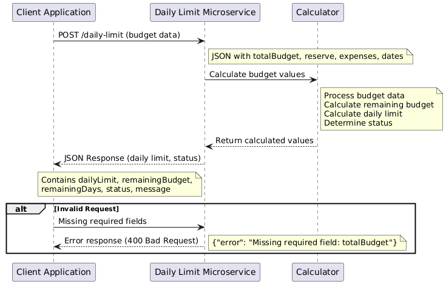

# Daily Spending Limit Calculator

A small Flask microservice that answers one question: **how much can I spend per day for the rest of the month and still stay on budget?**

You send it your monthly budget, how much you want to keep in reserve, what you've spent so far, and today's date. It sends back a daily limit plus a status (`ok`, `warning`, `over`, or `ended`).

I built this for CS361 (Software Engineering I) at Oregon State. The assignment was to write a microservice that a teammate's app would call over HTTP, so the README doubles as the "communication contract" between the two programs.

## Quick start

```bash
pip install -r requirements.txt
python app.py                 # runs on http://127.0.0.1:5000
python test_client.py         # in a second terminal: sends a demo request
python -m unittest -v         # runs the unit tests (server doesn't need to be running)
```

The server binds to `127.0.0.1` with debug off by default. Use `HOST`, `PORT`, and `FLASK_DEBUG=1` environment variables to change that.

## How it calculates

```
remainingBudget = totalBudget - reserve - sum(expenses)
remainingDays   = endDate - currentDate + 1        (today counts)
dailyLimit      = remainingBudget / remainingDays  (rounded DOWN to the cent)
```

Rounding down is on purpose. If you spend exactly the daily limit every day, you never end up a few cents over.

| Status    | When                                              | dailyLimit |
|-----------|---------------------------------------------------|------------|
| `ok`      | More than 20% of the total budget is left         | calculated |
| `warning` | 20% or less of the total budget is left           | calculated |
| `over`    | Spending has used up everything except the reserve | `0`        |
| `ended`   | `currentDate` is after `endDate`                   | `0`        |

## Communication contract

### Request

`POST /daily-limit` with a JSON body:

| Field         | Type   | Notes                                         |
|---------------|--------|-----------------------------------------------|
| `totalBudget` | number | Monthly budget, must be ≥ 0                   |
| `reserve`     | number | Emergency money to leave untouched, ≤ budget  |
| `expenses`    | list   | Each item needs an `amount` (≥ 0); `date` is optional |
| `endDate`     | string | Last day of the budget period, `YYYY-MM-DD`   |
| `currentDate` | string | Today, `YYYY-MM-DD`                           |

An optional `X-Correlation-ID` header is echoed back so the calling app can match requests to responses in its logs. If you don't send one, the service generates a UUID.

```python
import requests

resp = requests.post(
    "http://localhost:5000/daily-limit",
    headers={"X-Correlation-ID": "your-request-id"},
    json={
        "totalBudget": 2000.00,
        "reserve": 300.00,
        "expenses": [
            {"date": "2025-05-01", "amount": 500.00},
            {"date": "2025-05-05", "amount": 120.50},
        ],
        "endDate": "2025-05-31",
        "currentDate": "2025-05-07",
    },
)
print(resp.json())
```

### Response

`200 OK`:

```json
{
  "dailyLimit": 43.18,
  "remainingBudget": 1079.5,
  "remainingDays": 25,
  "status": "ok",
  "message": "You are on track with your budget.",
  "correlationId": "your-request-id"
}
```

`400 Bad Request` when a field is missing or invalid (wrong type, negative, bad date format, reserve larger than budget):

```json
{
  "error": "Missing required field: totalBudget",
  "correlationId": "your-request-id"
}
```

Unexpected errors return `500` with a generic message. The details are logged on the server instead of being sent back to the caller.

### Sequence diagram



## Project layout

```
app.py            the microservice (validation, calculation, Flask route)
test_app.py       unit tests
test_client.py    demo client that calls the running server
docs/             sequence diagram
```

## License

MIT
